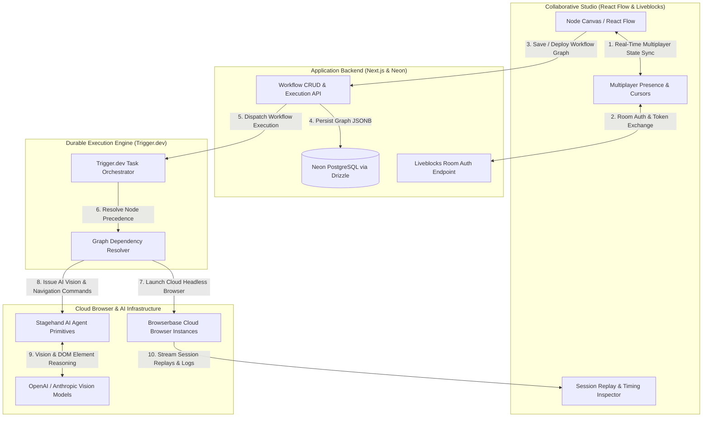

<div align="center">

# GNTI | Automata

<p><strong>Collaborative Visual Browser Automation Builder with AI-Powered Stagehand Actions & Full Session Replays</strong></p>

<p>A flagship production foundation engineered by <a href="https://gnti.tech">Galaxy Nova Technologies & Innovations (GNTI)</a>.</p>

<p>
  <a href="https://gnti.tech"></a>&nbsp;
  <a href="https://github.com/GNTI-X/automata"></a>&nbsp;
  <a href="./LICENSE"></a>&nbsp;
  <a href="https://gnti.tech/projects/automata"></a>
</p>

</div>

---

## 📌 1. System Overview

**Automata** is a collaborative, visual browser automation platform designed to simplify complex web workflows, data extraction, and autonomous web agent tasks. Built upon an infinite React Flow canvas with real-time multiplayer presence powered by Liveblocks, Automata enables distributed teams to collaboratively design, configure, and inspect browser automation DAGs (directed acyclic graphs).

Workflows are executed through durable Trigger.dev background tasks that launch cloud browser instances on Browserbase. Using Stagehand's AI-guided browser primitives (`act`, `extract`, `observe`), Automata can navigate dynamic web applications, circumvent bot-detection hurdles, extract structured data via Zod schemas, and record full video session replays for complete operational visibility.

---

## 🏛 2. Architecture & System Flow

### System Architecture Diagram



### End-to-End Workflow

1. **Visual Composition & Multiplayer Collaboration**:
   - Engineers assemble automation DAGs by connecting typed nodes: Navigation, AI Action (`act`), Data Extraction (`extract`), Observation (`observe`), Wait, and Conditional Branching.
   - Liveblocks maintains real-time CRDT synchronization across connected team members, showing live cursor positions, node drags, and parameter changes.
2. **Durable Task Dispatch**:
   - On execution, the graph definition is validated and persisted as a `jsonb` graph in PostgreSQL.
   - The execution engine enqueues a durable Trigger.dev task, ensuring idempotent execution, automatic retry on network drops, and graceful recovery.
3. **Cloud Browser Provisioning & AI Automation**:
   - Trigger.dev requests a managed Chromium browser session from Browserbase.
   - Stagehand attaches to the remote browser CDP (Chrome DevTools Protocol) session. Instead of brittle CSS selectors, Stagehand leverages multimodal LLMs to identify elements by visual context and natural language intent.
4. **Data Extraction & Session Replay**:
   - Extracted JSON payloads are passed downstream through the graph edges using JSONPath expressions.
   - Browserbase records screencasts, console outputs, and network HAR logs, providing developers with video playback and execution timestamps directly in the UI.

---

## 🛠 3. Categorized Tech Stack

| Domain | Technology | Purpose |
|:---|:---|:---|
| **Canvas UI** | `@xyflow/react` (React Flow) | High-performance interactive node canvas with custom step nodes |
| **Multiplayer Sync** | `Liveblocks` | Real-time presence, multi-user cursors, and shared room state |
| **Durable Execution** | `Trigger.dev` | Fault-tolerant, durable background task queue for long-running automations |
| **Cloud Browsers** | `Browserbase` | Scalable cloud Chromium infrastructure with proxy routing and session recording |
| **AI Web Primitives** | `Stagehand` | AI-powered autonomous browser interactions (`act`, `extract`, `observe`) |
| **Database & ORM** | `PostgreSQL` (Neon) via `Drizzle` | Storing workflow definitions, execution logs, and organization access |
| **Authentication** | `Clerk` | Organization management, user roles, and team workspace isolation |

---

## 🗄 4. Domain Data Model & Entity Relationships

- **`workflows`**:
  - `id`: UUID Primary Key
  - `orgId`: text (Clerk organization identifier)
  - `name`: text
  - `graph`: JSONB structure storing:
    - `nodes`: Array of step nodes (Type, coordinates, parameters like target URL, action instruction, extraction schema)
    - `edges`: Array of directional links with input/output port bindings
  - `createdAt`, `updatedAt`: Timestamps

---

## 🔑 5. Environment Variables Reference

| Variable | Required | Description |
|:---|:---:|:---|
| `DATABASE_URL` | **Yes** | PostgreSQL connection string |
| `NEXT_PUBLIC_CLERK_PUBLISHABLE_KEY` | **Yes** | Clerk public key |
| `CLERK_SECRET_KEY` | **Yes** | Clerk secret key |
| `LIVEBLOCKS_SECRET_KEY` | **Yes** | Liveblocks server authorization key |
| `TRIGGER_SECRET_KEY` | **Yes** | Trigger.dev project API key |
| `BROWSERBASE_API_KEY` | **Yes** | Browserbase cloud browser access key |
| `BROWSERBASE_PROJECT_ID` | **Yes** | Browserbase project identifier |
| `OPENAI_API_KEY` | **Yes** | OpenAI API key for Stagehand vision and reasoning |

---

## 🚀 6. Local Development & Deployment

```bash
# 1. Clone repository
git clone https://github.com/GNTI-X/automata.git
cd automata

# 2. Configure environment
cp .env.example .env

# 3. Install dependencies
npm install

# 4. Migrate Database Schema
npx drizzle-kit push

# 5. Start Trigger.dev agent (separate terminal)
npx @trigger.dev/cli@latest dev

# 6. Run Next.js application
npm run dev
```

---

## 🏢 About GNTI

Galaxy Nova Technologies & Innovations (GNTI) builds and deploys scalable software across multi-tenant SaaS, real-time communication, AI automation, and media streaming infrastructure.

- **Website**: [gnti.tech](https://gnti.tech)
- **Official Specification**: [gnti.tech/projects/automata](https://gnti.tech/projects/automata)
- **Inquiries**: [contact@gnti.tech](mailto:contact@gnti.tech)

---

## 📄 License

Distributed under the **MIT License**. See [LICENSE](./LICENSE) for details.

Copyright &copy; 2026 [Galaxy Nova Technologies & Innovations (GNTI)](https://gnti.tech). All rights reserved.
